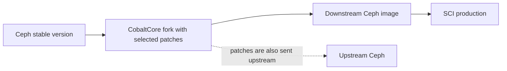

# Downstream Ceph images

CobaltCore runs Ceph for cloud storage. Sometimes production needs a fix or feature sooner than the upstream Ceph project can review and include it in an official release. We maintain a downstream image so we can deliver those changes on our schedule.

## What the downstream image contains

A downstream image packages a Ceph stable version together with selected patches from the [CobaltCore Ceph fork](https://github.com/cobaltcore-dev/ceph). The fork is our copy of Ceph's source code, and it contains the downstream patches that we need.

Each patch is also contributed to [upstream Ceph](https://github.com/ceph/ceph). We prefer to have it accepted upstream, but we do not have to wait for upstream to merge it before using the patch in our image. This helps us meet production needs while keeping our changes connected to the Ceph project.

We keep the fork close to upstream by contributing our changes back and incorporating upstream changes over time.

## How we keep track of releases

The Cloud storage project's **Releases** view groups downstream pull requests by Ceph release line. We use it to see which fixes and features are being considered for an internal image version and to maintain that version's change list and changelog.

The view helps us organize the work. The built image comes from a specific state of the fork, and its image digest identifies the exact artifact that was tested and released. This lets the team connect the changes we planned with the image used in production.

## Related projects

- [CobaltCore Ceph fork](https://github.com/cobaltcore-dev/ceph) - downstream patches and source used to build our image
- [Ceph upstream](https://github.com/ceph/ceph) - the original Ceph project where changes are contributed
