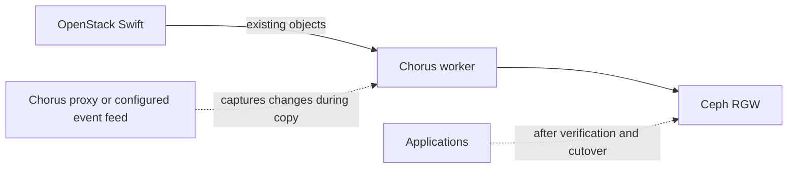

# Swift-to-Ceph migration with Chorus

[Chorus](./chorus.md) can copy object data from OpenStack Swift to Ceph RGW. RGW provides a Swift-compatible API, so Chorus can use the Swift protocol at both ends of this migration.

Chorus copies existing objects in the background. A migration policy selects either all buckets for a project or specific buckets. The policy copies data in one direction, from the Swift source to the Ceph destination.

## Migration flow

The migration has five main parts:

1. **Choose what to move.** Select the project or buckets and map each source bucket to its destination.
2. **Copy existing data.** Chorus workers copy objects from Swift to Ceph RGW in the background.
3. **Capture changes made during the copy.** A configured Chorus Proxy or supported event feed must capture new writes if applications continue writing to Swift.
4. **Check the result.** Verify every expected source and destination bucket pair. Reaching 100% copy progress alone does not confirm that the stores match.
5. **Switch applications to Ceph.** After verification, change the client endpoint through the normal change process and confirm clients can access the expected data.

## Online and write-frozen migrations

An online migration can capture writes while the initial copy is running, but only when the Proxy or event feed is configured and tested. Chorus does not automatically capture writes made directly to Swift when neither mechanism is active.

::: warning
If the migration has no working write-capture mechanism, stop writes to Swift before the copy and keep them stopped until verification and cutover are complete. In this mode, Chorus copies an initial snapshot of the data; it does not keep the two stores synchronized while writes continue.
:::

## Verification and cutover

Check each bucket that is part of the migration. Investigate any differences and repeat the check until the expected source and destination contents are consistent. Do not switch applications to Ceph based on copy progress alone.

Once the checks pass, route applications to the Ceph RGW Swift endpoint and verify their access. Keep a rollback plan and the source data available for the agreed recovery period. Because the migration copies in one direction, changes written to Ceph are not automatically copied back to Swift.

## Related pages

- [Chorus overview](./chorus.md)
- [Ceph storage](./ceph.md)
